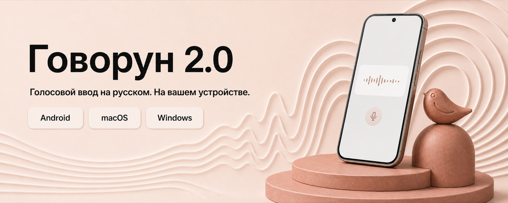
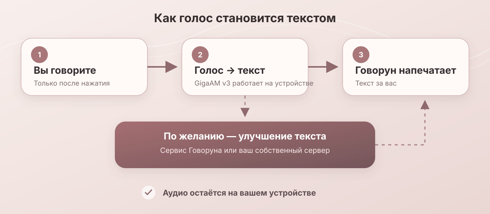

<p align="center">
  
</p>

<p align="right">
  <a href="https://www.rustore.ru/catalog/app/com.govorun.lite?rsm=1&utm_source=available_in_rustore"></a>
</p>

Говорун — умный голосовой ввод. Говорите, и текст появляется там, где вы
печатаете: в мессенджере, почте, заметках, документах.

Речь распознаётся прямо на устройстве: бесплатно, без интернета, аккаунта и подписок.
Звук никуда не отправляется.

## Скачать

**Говорун для компьютера уже установлен? Скачивать заново не нужно:** обновляйтесь прямо в
приложении, кнопкой «Проверить обновления» в разделе «О программе». Настройки, словарь и
статистика сохранятся.

Новые версии всегда сначала появляются на GitHub. Android и компьютер выходят
отдельными релизами:

- **[Android](https://github.com/amidexe/govorun-lite/releases?q=Android&expanded=true)** — APK.
- **[Windows и macOS](https://github.com/amidexe/govorun-lite/releases?q=Windows&expanded=true)** — установщики.
- **[RuStore](https://www.rustore.ru/catalog/app/com.govorun.lite)** — Android. Удобно установить оттуда, а затем обновиться
  до последней версии с GitHub.
- **Obtainium** — добавьте адрес `https://github.com/amidexe/govorun-lite` с настройками по умолчанию.
  Obtainium сам выберет релизы с APK и будет предлагать только обновления для Android.

## Что умеет Говорун 2

- **Диктовка в любое приложение.** На телефоне — кнопкой-птичкой, на компьютере — сочетанием клавиш. Текст появляется там, где курсор.
- **Один Говорун на телефоне и компьютере.** Android, macOS и Windows с общим словарём, стилями и статистикой.
- **Два режима ввода на телефоне.** Обычный — текст появляется по ходу речи, фраза за фразой. Новый, с подтверждением, — договорите мысль целиком, а потом вставьте текст или отмените.
- **Свой словарь.** Имена, термины и замены; новые слова можно добавлять голосом.
- **Статистика.** Сколько слов и времени вы надиктовали.
- **Улучшение текста нейросетью (бета).** Убрать повторы, сократить, оформить в нужном стиле — через свой OpenAI-совместимый сервер без аккаунта или через сервис Говоруна.
- **Текст не привязан к аккаунту.** Сервис Говоруна получает текст по одноразовому анонимному пропуску и не может связать его с вашим аккаунтом.
- **Синхронизация.** Настройки, словарь и стили на всех ваших устройствах — по желанию, после входа.
- **Доступность.** Отдельные озвучиваемые действия для экранного диктора.
- **Recognition API для разработчиков.** Другие Android-приложения — заметки, планеры, дневники — могут распознавать речь через Говорун, без своей модели и интернета. [Подробнее](#recognition-api)

Если улучшение не сработало, вставляется обычный распознанный текст.

## Говорун.Эхо

Скоро: дополнение к Говоруну для Android. Голосовые заметки, которые сразу
становятся текстом: лекции, встречи, мысли по дороге домой. Звук и текст лежат
рядом, а слова можно коснуться, и запись зазвучит с них. Распознаёт речь Говорун
на вашем телефоне.

## Установка

| Система | Что нужно |
| --- | --- |
| Android | Android 12 и новее. После установки разрешите микрофон и включите Говоруна в «Специальных возможностях» — так он сможет вставлять текст |
| macOS | Mac на Apple Silicon (M1 и новее), macOS 13.4 и новее. Перенесите приложение из DMG в «Программы» и выдайте разрешения при первом запуске |
| Windows | Windows 10 или 11, 64-бит. Установщик не просит прав администратора |

**Какой нужен компьютер.** Для Windows — процессор с 4 ядрами и от 8 ГБ памяти,
лучше 16 ГБ. Видеокарта с Vulkan 1.2+ ускоряет распознавание; без неё работает
процессор, и он заметно нагружается. Для Mac — M1 или новее и от 8 ГБ памяти.
Насколько быстро Говорун работает именно на вашем компьютере, покажет встроенная
«Проверка распознавания».

**Если система предупреждает при первом запуске.** Приложения для компьютера
пока не подписаны сертификатами Apple и Microsoft. На Mac: правый клик по
приложению → «Открыть» ([справка Apple](https://support.apple.com/102445)).
На Windows: «Подробнее» → «Выполнить в любом случае». На Android при установке
APK может понадобиться разрешить «ограниченные настройки»
([справка Android](https://support.google.com/android/answer/12623953?hl=ru)).
Контрольные суммы SHA-256 — в файле `SHA256SUMS` каждого релиза.

Обновления приходят прямо в приложении: после входа в аккаунт Говорун проверяет их сам,
без входа — по кнопке «Проверить обновления» в разделе «О программе». В настройках можно
выбрать стабильный канал или тестовый — в нём новые версии появляются раньше.

## Улучшение текста и приватность

Звук всегда остаётся на устройстве. Улучшение текста — необязательная часть: без неё
распознавание и всё остальное работают офлайн и бесплатно. Включается оно отдельно,
и вы сами выбираете, куда отправлять текст:

- **Свой сервер.** Любой OpenAI-совместимый сервер, аккаунт не нужен. Текст идёт
  напрямую на ваш сервер по HTTPS (обычный HTTP — только для сервера на этом же компьютере).
- **Сервис Говоруна.** Платный, сейчас работает в режиме «Промо»: бесплатно, с дневным
  и общим лимитом. Нужны аккаунт и согласие с [условиями](https://govorun.club/legal).
  Отправляются распознанный текст, выбранный стиль и одноразовый анонимный
  пропуск — без имени и данных аккаунта. Пропуска выдаются «вслепую»
  (слепая подпись RSA, RFC 9474): сервис проверяет, что пропуск настоящий,
  но не может узнать, какому аккаунту он был выдан. Мы не храним тексты. Обработку выполняет
  OpenAI (США): тексты не используются для обучения и могут храниться до 30 дней
  для защиты от злоупотреблений.

Синхронизация не передаёт звук, тексты диктовок и буфер обмена; словарь и стили
хранятся на сервере зашифрованными.

### Что уходит в сеть

| Когда | Что |
| --- | --- |
| Без входа | Ничего автоматически. Обновления на компьютере проверяются только по кнопке |
| После входа | Аккаунт, синхронизация настроек, словаря, стилей и статистики (в том числе число улучшений и сбоев), проверка обновлений — не чаще раза в 6 часов. Push-уведомления на Android — только с вашего согласия |
| Улучшение через сервис Говоруна | Кроме самого текста — обезличенные коды сбоев из фиксированного списка и отметка «вставлено / не вставлено», без текста и аккаунта |

В приложениях нет аналитики, рекламы и сторонних сборщиков ошибок. Журнал
диагностики остаётся на устройстве: отправить его можете только вы.

## Для разработчиков

### Recognition API

Хотите добавить в своё приложение распознавание русской речи, но не тащить
в него модель на сотни мегабайт? Если у пользователя установлен Говорун, ваше
приложение может просто попросить его распознать речь. Диктофон, заметки,
планер или мессенджер с голосовым вводом может весить несколько мегабайт,
а распознавание будет на модели GigaAM — прямо на устройстве, без интернета
и без серверов.

Сегодня небольшую утилиту под свою задачу легко написать вместе с ИИ. Говорун
закрывает самую тяжёлую часть — распознавание речи, — и вашему приложению не нужно
таскать с собой ещё одну нейросеть.

**Как это работает**

1. Приложение подключается к сервису `com.govorun.api.RECOGNITION_SERVICE`.
2. При первом обращении Говорун сам спрашивает пользователя, разрешить ли
   вашему приложению доступ. Разрешение привязано к подписи вашего приложения;
   пользователь может отозвать его в настройках Говоруна.
3. Вы передаёте звук — готовую запись любой длины или поток (PCM, 16 кГц,
   моно, 16 бит) — и получаете текст. В потоковом режиме текст приходит фраза
   за фразой, плюс события «говорит / замолчал». По запросу — со временем
   каждого слова.

Несколько приложений могут работать одновременно: Говорун распознаёт по
фразам, живой поток идёт первым, длинные записи — в промежутках. Память
Говоруна не растёт от длины записи.

Микрофон записывает ваше приложение, Говорун только распознаёт переданный звук.
Аккаунт и интернет не нужны. [Описание интерфейса (AIDL)](android/app/src/main/aidl/com/govorun/api/v1).

**Статус: экспериментальный.** Отзывов от разработчиков пока мало, и API будет
улучшаться — возможны изменения. Попробуйте и расскажите, чего не хватает
и что неудобно: это сильно поможет.

### Как устроен код

<p align="center">
  
</p>

| Папка | Что внутри |
| --- | --- |
| [shared/core](shared/core) | Общая логика на Rust |
| [shared/core-http](shared/core-http), [shared/styles-http](shared/styles-http) | Сетевые запросы: аккаунт и улучшение текста |
| [shared/jvm-bridge](shared/jvm-bridge) | Связь ядра с Android |
| [shared/schema](shared/schema) | Типы данных, сгенерированные из ядра |
| [android/app](android/app), [android/product-ui](android/product-ui) | Приложение для Android |
| [desktop/src](desktop/src) | Интерфейс приложения для компьютера (Svelte) |
| [desktop/src-tauri](desktop/src-tauri) | Приложение для компьютера на Tauri: окна, хранилище, обновления |
| [desktop/os-runtime](desktop/os-runtime) | Микрофон, клавиши и вставка текста на macOS и Windows |
| [desktop/vendor/handy-keys](desktop/vendor/handy-keys) | Глобальные клавиши из проекта Handy (MIT) с нашими небольшими правками — они описаны в `LOCAL_CHANGES.md` |
| [macos](macos), [windows](windows) | Ресурсы и подготовка библиотек для сборки; отдельных приложений здесь нет |

Речь распознаёт модель GigaAM v3, паузы отделяет Silero VAD. На Android
работает sherpa-onnx, на компьютере — transcribe.cpp с ускорением через Metal
на Mac и Vulkan на Windows.

### Сборка из исходников

Модели и библиотеки скачиваются при подготовке, их контрольные суммы
проверяются. Свою сборку подписывайте своим ключом.

**Android.** Нужны JDK 17, Android SDK, NDK 28.2.13676358, Rust, Python 3,
Bash и curl; переменная `ANDROID_HOME` должна указывать на SDK.

```bash
rustup target add aarch64-linux-android
cd android
./scripts/download-sherpa-onnx.sh
./scripts/download-model.sh
./scripts/download-runtime-assets.sh
./gradlew :app:assembleDebug
```

Готовый APK: `android/app/build/outputs/apk/debug/app-debug.apk`. Отладочная
сборка ставится рядом с обычной и не заменяет её.

**Компьютер.** Нужны Node.js 22.12+ или 24+, Rust и Python 3. На Mac — Xcode
с Command Line Tools, на Windows — PowerShell 7 и Visual Studio Build Tools
с C++ и Windows SDK.

```bash
# macOS, Apple Silicon
python3 desktop/scripts/build-macos.py
```

```powershell
# Windows x64, Developer PowerShell
pwsh -File desktop/scripts/build-windows.ps1
```

Типы для Kotlin и TypeScript создаёт [генератор](shared/scripts/generate-boundary-models.py).

## Лицензии

Код распространяется по лицензии [MIT](LICENSE). Лицензии сторонних библиотек:
[компьютер](desktop/THIRD_PARTY_LICENSES.txt),
[Android](android/app/src/main/assets/third_party_licenses.txt),
[macOS](macos/THIRD_PARTY_LICENSES.txt), [Windows](windows/THIRD_PARTY_LICENSES.txt).

Название «Говорун», птичка и фирменные изображения по MIT не передаются —
подробности в [BRAND_NOTICE.txt](BRAND_NOTICE.txt).

## Благодарности

Говорун построен на работе замечательных открытых проектов. Спасибо их авторам:

- [GigaAM](https://github.com/salute-developers/GigaAM) — распознавание русской речи;
- [Silero VAD](https://github.com/snakers4/silero-vad) — определение речи и пауз;
- [sherpa-onnx](https://github.com/k2-fsa/sherpa-onnx) — распознавание на Android;
- [Handy](https://github.com/cjpais/Handy) и [transcribe.cpp](https://github.com/handy-computer/transcribe.cpp) — горячие клавиши, запись звука и распознавание на компьютере;
- [Tauri](https://github.com/tauri-apps/tauri) — основа приложения для компьютера;
- [Svelte](https://github.com/sveltejs/svelte) — интерфейс приложения для компьютера.

Отдельное спасибо участникам [4PDA](https://4pda.to/forum/index.php?showtopic=1121176) и сообществу Хабра
за обратную связь и помощь в тестировании.

---

[govorun.club](https://govorun.club) · [Условия и политика](https://govorun.club/legal) · [Тема на 4PDA](https://4pda.to/forum/index.php?showtopic=1121176) · [Говорун 1 — только офлайн](https://github.com/amidexe/govorun-lite/releases/tag/v1.0.15)
